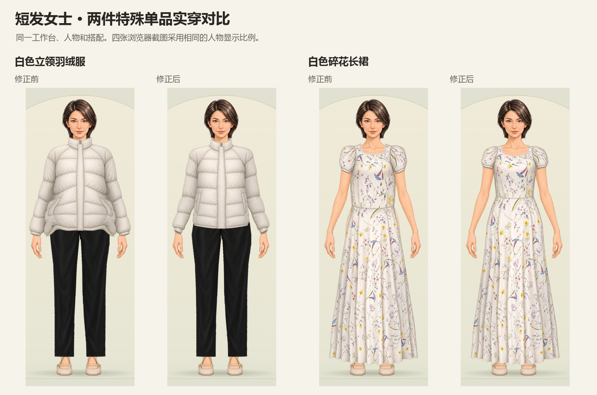

# WearMate · 白色立领羽绒服与白色碎花长裙实穿修正

**当前短发角色 `woman-bob` 的正面工作台试穿，已达到本轮结构修正目标。** 羽绒服最明显的改善在袖口、插肩缝和侧摆。碎花裙的改善集中在上身长度、袖口与手臂的交界，以及腰线以下的髋部覆盖。下图可以先看全身比例，再打开各节的局部原图查看接缝。

## 羽绒服

原版本的后领亮边横过颈部，胸前的绗缝在两侧大幅折弯。袖口和衣身下摆共用一套变形控制点，手腕附近向下展开的幅度也带到了衣身，两个下摆角垂到了中间拉链以下。袖身与衣身之间另有一块按扫描行填出的布片，放大后能看出横纹。

| 部位 | 本轮处理 | 同视角复查 |
|---|---|---|
| 领口、肩部 | 沿原立领的椭圆内缘分出前后领片，后领排在头颈后方。沿插肩线分别裁出两袖和衣身，肩头至腋下留少量原布重叠。 | 后领的横亮边消失。领前弧、拉链和左右斜肩缝连成一体，肩缝放大后无裸肤细缝。 |
| 胸廓、袖窿 | 衣身的绗缝按胸侧、前中和腰侧分别定位。以原插肩布料覆盖袖窿，撤掉旧的横向补缝。 | 胸前保有羽绒厚度，两侧绗线沿肋部回转，腋下的横向填充纹消失。 |
| 袖口、手腕 | 两只袖子跟随各自手臂对位，分别固定袖肚、罗纹两端和斜向袖口，在皮肤接触处保留柔和的窄阴影。 | 袖口顺着手腕斜收，罗纹以下露出手掌，袖肚仍有余量。 |
| 衣身下摆 | 单独定位口袋、侧缝下端、收边及前中拉链。 | 左侧代表点 `x=145` 处下缘由 `y=741` 变为 `710`，前中 `x=278` 由 `734` 变为 `724`。旧侧摆低于前中，现在由侧缝向前中缓慢下落。 |

[羽绒服修前全身](stage3a-dress-coat-fix-evidence/before-coat.png) · [修后全身](stage3a-dress-coat-fix-evidence/after-coat.png) · [肩袖、手腕与下摆放大对照](stage3a-dress-coat-fix-evidence/coat-comparison.png)

## 碎花长裙

旧裙身从胸到腰近乎等宽，腰缝位置偏低，腰带附近另有一层横向阴影。泡袖显得长而方，手臂从袖子下方露出。旧裙片在两侧髋部还露出了一小条人物的米色打底。

| 部位 | 本轮处理 | 同视角复查 |
|---|---|---|
| 方领、肩部 | 分别对齐方领内角、前中、肩端与泡袖袖山，按肩面斜度放置领肩布料。 | 方领沿锁骨下方落下，左右肩带接上泡袖，保留颈部和锁骨的轮廓。 |
| 泡泡袖、袖口 | 收短泡袖落点，让袖口内外端沿上臂成斜面，固定袖窿边界，补入仅落在皮肤上的接触阴影。 | 泡量集中在肩头，袖口到上臂的过渡连续；靠腋下的侧缝也顺着胸侧向下。 |
| 胸口、腰线 | 重新对齐胸侧与收腰位置，前中腰缝控制点从 `y=621` 提至 `568`，左右侧缝略高；减弱原图腰缝的硬描边，去除原来覆盖整段的横阴影。 | 腰部在髋部以上自然收窄。腰缝仍可辨认，胸侧、腰省和裙身的碎花沿着轮廓连续过渡。 |
| 髋部、裙摆 | 在腰缝下方给两侧裙片补足髋部余量，继续沿用原长裙下摆的定位点。 | 规定髋部窗口内露出的母版像素从 1,704 降至 0。裙摆最低有效像素均在 `y=1427`，玛丽珍鞋鞋面继续可见。 |

[碎花裙修前全身](stage3a-dress-coat-fix-evidence/before-dress.png) · [修后全身](stage3a-dress-coat-fix-evidence/after-dress.png) · [方领、袖口与腰缝放大对照](stage3a-dress-coat-fix-evidence/dress-comparison.png)

## 复验与复现

- 打开[本地穿搭工作台](http://127.0.0.1:4173/?view=fitting)。选深蓝衬衫、黑色直筒裤、米白玛丽珍鞋，再穿白色立领羽绒服。脱下外套，切到连衣裙，选白色碎花长裙。可以再穿一次羽绒服检查叠穿，然后脱下外套并切回上下装。
- Chrome 157、视口 1440 × 900、设备像素比 3。修前和修后从同一正式项目入口执行上述操作，以相同显示比例截取人物。实测外套两个图层均加载，穿上时覆盖内搭；裙装与上衣、裤子互斥，鞋仍显示。先脱外套再切回上下装，恢复原深蓝衬衫与黑裤。两组同位置脸部截图逐像素一致。[修后外套叠裙全身](stage3a-dress-coat-fix-evidence/after-layered.png)
- `node --test` 通过 36/36。`node scripts/verify-woman-bob.cjs` 通过衣橱试穿及 28 种分层组合。本轮两件衣服的正面贴合度另以工作台截图复核。
- 像素统计使用实际 560 × 1536 透明图层，坐标从左上角起算。髋部窗口为 `127 ≤ x < 427`、`640 ≤ y < 740`，计数条件为人体 Alpha 大于 225 且裙装 Alpha 小于 128。这个窗口覆盖原有露边。[原始测量值](stage3a-dress-coat-fix-evidence/measurements.json)
- 使用 Python、NumPy、Pillow 和项目现有插画进行局部曲面映射。运行版更新了[羽绒服前片](assets/wardrobe/tryon/woman-bob/standard/white-puffer.webp)、[羽绒服后领](assets/wardrobe/tryon/woman-bob/standard/white-puffer-back.webp)和[碎花裙](assets/wardrobe/tryon/woman-bob/standard/floral-maxi.webp)。从项目根目录执行 `python scripts/fit-standard-bob.py --phase coat` 或 `--phase dress` 可单独重建对应图层。[制作脚本](scripts/fit-standard-bob.py)

## 仍有的局限

从正面全身尺度看，衣身两侧卷角和裙侧露底这两处最明显的问题已消除。放大后，羽绒服左右绗缝的饱满程度仍较对称，碎花裙胸前的细小褶皱仍主要依靠原插画和局部明暗表达。本次验收仅覆盖当前母版的固定正面站姿与闭合羽绒服穿法。
