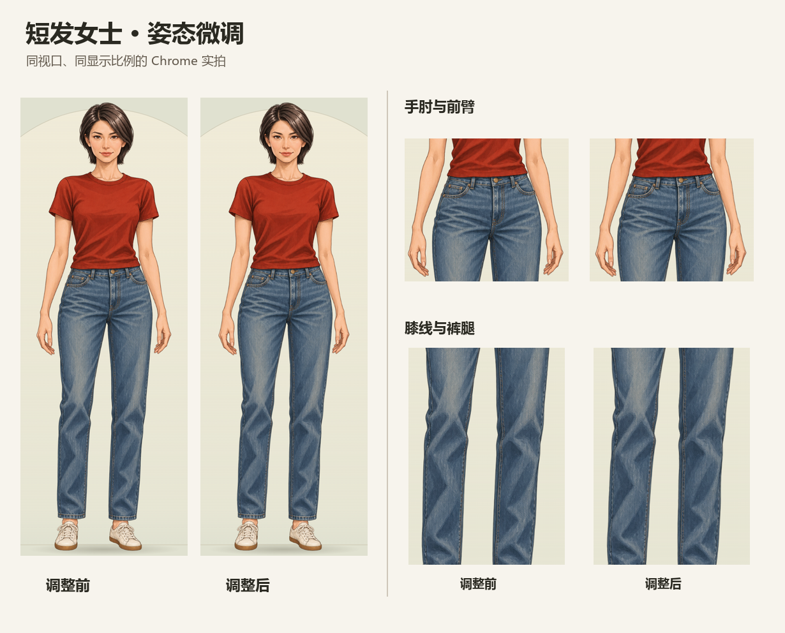

# WearMate · 短发女士姿态微调

**新版默认造型的手臂更松弛，腿部线条更顺直。** 本轮沿用同一位短发女士 `woman-bob` 的 560 × 1536 立绘，只调整双臂和牛仔裤图层。头脸、发型、肩腰和落脚位置沿用原稿。

## 实际微调

| 部位 | 调整 | 复查 |
|---|---|---|
| 双肘和前臂 | 从袖口下方逐步收顺外侧线条。画面左臂在肘至前臂段最多内移 12 像素，右臂肘外缘最多内移 10 像素，靠身体一侧移动更少。手腕到手指作为整体随下臂少量移动。 | 袖口接缝和原手型一致，手臂内侧仍与腰胯留有空隙。 |
| 双腿 | 沿膝部到小腿对两条裤腿分别作平缓的横向位移。画面左腿最多 6 像素，右腿最多 8 像素，沿踝部逐渐归零。 | 膝线少了向外折的感觉，裤腿保留原本的直筒宽度和褶皱。双脚仍处在原有落点，原来的轻微外转保留。 |
| 头脸和比例 | 直接加载同一张头脸图层。衣服类别、上身肩腰比例和鞋子继续沿用重绘版。 | 同尺寸浏览器截图对比，头脸、发型、颈部以及裤脚与鞋的区域均为 **0 个像素变化**。 |

处理对原有画稿做离线曲线对位。新 [手臂图层](assets/local-avatar/woman-bob/rebuilt/arms-pose-tweak.webp) 和 [牛仔裤图层](assets/local-avatar/woman-bob/rebuilt/blue-denim-pose-tweak.webp) 从各自的原图层生成。点位和导出方式见[脚本](scripts/tweak-woman-bob-pose.py)。

## 浏览器复验

- Chrome 157 在 1440 × 900 桌面视口读取六张当期独立图层，正式首页实测无页面脚本错误。[调整前全身](stage3a-female-avatar-pose-tweak-evidence/before-full.png) · [调整后全身](stage3a-female-avatar-pose-tweak-evidence/after-full.png) · [调整后半身](stage3a-female-avatar-pose-tweak-evidence/after-half.png)
- 390 × 844 手机视口实查人物完整可见，无横向溢出。[手机截图](stage3a-female-avatar-pose-tweak-evidence/after-mobile.png)
- 从前后两张 442 × 1212 的人物截图按相同区域逐像素比对，头发至颈部、袖口和双脚均无变化。[像素数据](stage3a-female-avatar-pose-tweak-evidence/pixel-checks.json)
- `node --test` 36 项通过。原工作台的 28 种换装组合回归通过。

**结论。** 当前红 T 与直筒牛仔裤造型更自然，足以继续作为这一角色的正面试衣母版。视觉结论针对默认装；其它款式对新版母版的适配仍沿用上一轮的验收边界。
