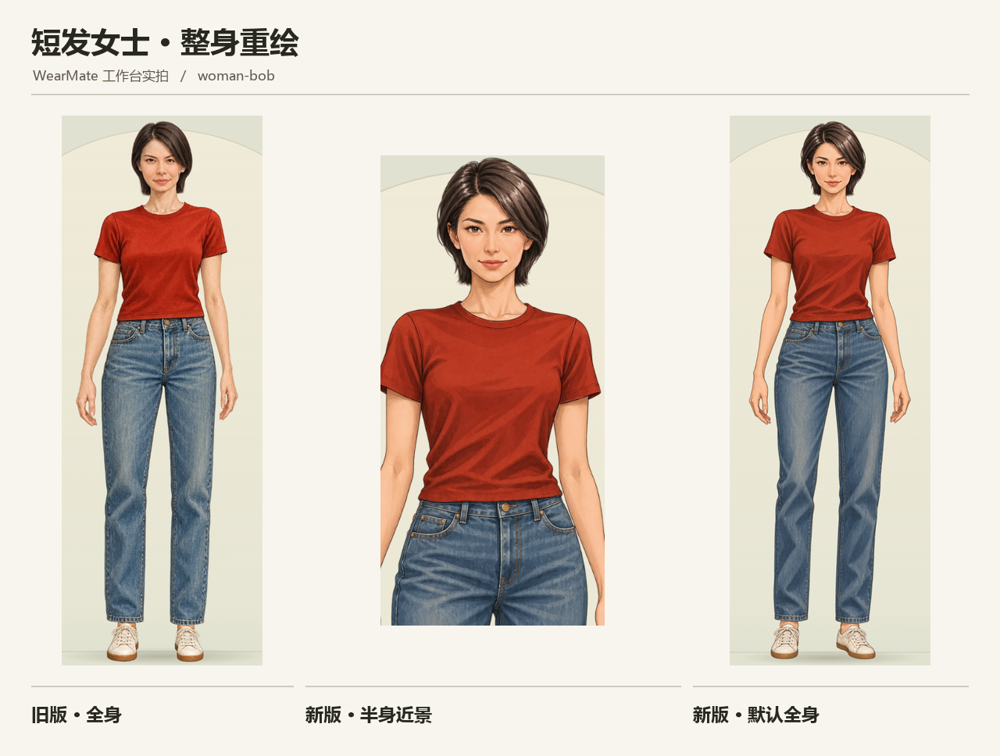

# WearMate · 短发女士整身重建验收

角色仍是 `woman-bob`。此次从同一张整身插画里重建脸、短发、身体、手脚和默认穿搭。新母版已在工作台首页展示，可以作为下一轮衣物制版的起点。当前验证的是人物造型和默认三件的结构，审批其他衣物的上身效果需要在新坐标下另做。

## 1. 整体重建的依据

旧版的脸部通过局部插入重新处理，手臂、腿和衣物仍具有不同的边缘、纹理密度和光影。半身看时，脸和身体之间有可辨认的渲染差别。全身看时，肩、腿和双脚近似平行，正面姿势显得僵硬。基于这些关系，重建前先确定全身统一的线条、光照与重心，再依服装和皮肤的明确分界拆层。[旧版工作台](stage3a-female-avatar-rebuild-evidence/previous-workbench.png) · [旧版全身](stage3a-female-avatar-rebuild-evidence/previous-avatar.png)

## 2. 风格和身份

新版为偏二次元的轻写实时装立绘，使用清晰描线、成组的头发光面和柔化的分区阴影。脸、裸露手臂、脚踝、布料折线来自同一次整身绘制。保留了原角色的深棕侧分短发、鹅蛋形偏窄的下颌、暖中等肤色、棕色眼睛和略带不对称的闭口笑。插画化使眼型和发束更明确。角色身份的判断依据是前后外形可辨认的连续性。

开发期使用内置 ImageGen 生成两张整身候选，采用第二张。输入是项目原角色全身截图。选中稿的提示方向为“正面、约七个半头身的成熟女性，保留窄脸、深色侧分短发、暖肤色和自信微笑。使用轻写实时尚游戏立绘的笔触与分区光影，左右脚略不同朝向，双手完整可见。红棕圆领短袖、复古水洗直筒牛仔裤、浅奶油色运动鞋。单人全身、纯透明背景”。[整身制版母稿](artwork/woman-bob/rebuild-master.png) · [最终半身截图](stage3a-female-avatar-rebuild-evidence/rebuilt-half.png)

## 3. 实际重建内容

| 部位 | 修改 | 实际复查 |
|---|---|---|
| 脸与发型 | 整体重画眼、鼻、唇、面部轮廓和发束，脸侧的短发有完整形状 | 半身图可看到眼神、头发光面到颈部阴影的连续性 |
| 身体与肩线 | 以正面约七个半头身为目标，肩点 `(155,263) / (423,273)`，颈点 `(287,257)` | 上身以自然高低肩呈现，衣领和肩缝按新稿描边落位 |
| 腰、胯和腿 | 腰点 `(285,573)`，高腰线略带倾斜，腿部一侧放松，膝部褶皱随腿走向 | 全身画面能看到腰线、前裆与裤腿的自然过渡 |
| 手臂和双脚 | 两手自然垂在胯侧并留空，脚踝点 `(161,1420) / (334,1429)`，一只脚略外转 | 手与裤腿间有可见间隙，左右鞋的鞋舌和鞋底都可辨认 |

保留 `560 × 1536` 坐标协议。沿领口、两侧袖口、裤腰、裤脚和鞋口描出分界线，把完整绘稿离线拆为头颈、双臂、脚踝、红 T、牛仔裤、浅色鞋六个透明 WebP。每个像素由一个图层负责，导出脚本核对六层叠加与归一化母稿逐像素一致。浏览器通过实际渲染器加载这六张独立图片。可从 [角色姿态与图层注册](src/create/bob-rebuild.mjs)、[素材目录](assets/local-avatar/woman-bob/rebuilt/) 和[本地拆层脚本](scripts/layer-woman-bob.py)复核。

## 4. 浏览器验收

- [新版默认舞台正面](stage3a-female-avatar-rebuild-evidence/rebuilt-workbench.png)
- [新版默认全身图](stage3a-female-avatar-rebuild-evidence/rebuilt-full.png)
- [新版半身近景](stage3a-female-avatar-rebuild-evidence/rebuilt-half.png)
- [新版手机视口](stage3a-female-avatar-rebuild-evidence/rebuilt-mobile.png)
- [三个视图总览](stage3a-female-avatar-rebuild-evidence/overview.png)

在真实 Chrome 157 的 1440 × 900 和 390 × 844 视口验证，手机页面无水平溢出。测试了新母版六件图层的加载、已登记照片的创建预览和确认跳转、原工作台通勤装、模拟天气试穿跳回原工作台，以及新红 T 文件加载失败时自动退回原试衣。旧版的 28 种换装组合回归通过，`node --test` 共 36 项通过。

可从[首页](http://127.0.0.1:4173/)看新母版，从[原换装工作台](http://127.0.0.1:4173/?view=fitting)继续使用此前衣物。衣橱发起的商品试穿和今日穿搭仍使用各自已经验证的原版图层。新版首页只呈现本轮的默认造型。

## 5. 后续制版条件与当前边界

可以用现有母版做下一轮代表单品验证。应先确认用户认可这张全身稿，再用一件露出更多颈肩的上衣、一条不同裤腰高度的裤子和一双开口鞋，验证新母版在改变遮挡之后仍自然。新稿当前只包含默认造型下露出的皮肤区域，原 T 恤覆盖住的肩胸、牛仔裤覆盖住的腿，以及运动鞋内的脚背，仍需在对应款式制作时补足。手部和拇指目前以正常工作台显示距离验收，放大插画仍可继续检查。其他衣物目前留在原版底盘使用，所有新底盘的跨套换装质量均待验证。
