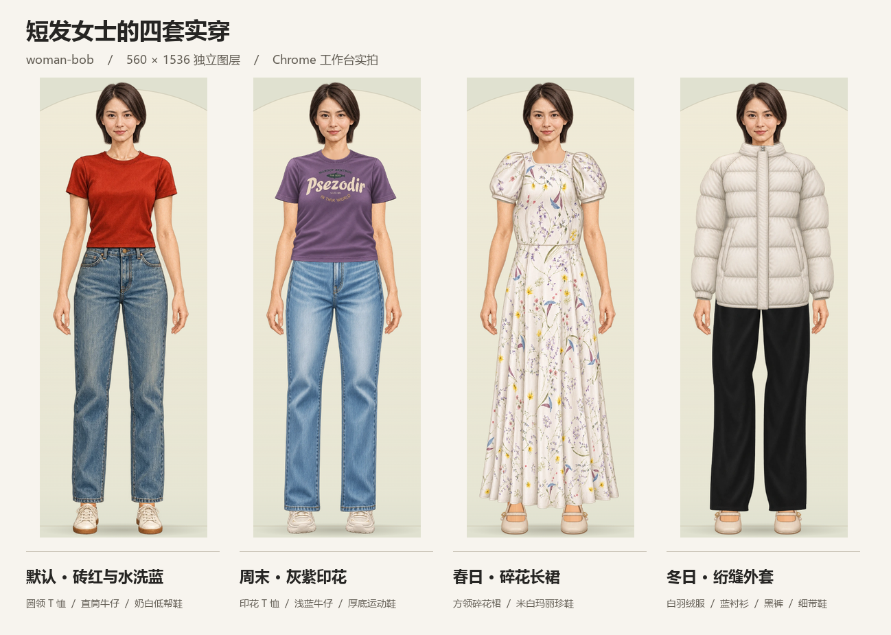
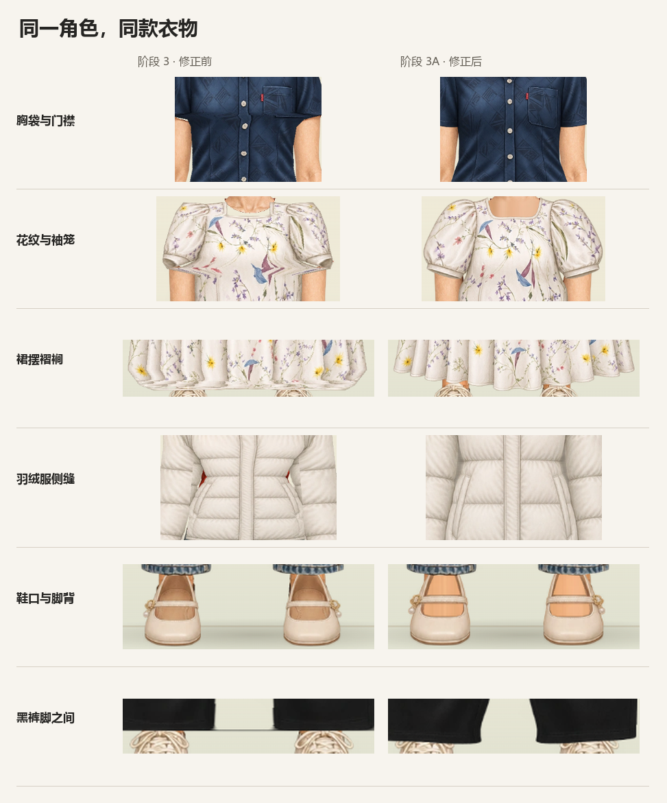

# WearMate 阶段 3A · 短发女士的专属衣橱

**验收结论：通过本角色的本地演示验收。** 短发女士 `woman-bob` 保留了原来的脸、发型、站姿和砖红色默认造型。她的数字衣橱收录 9 件专属单品，可从衣橱直接试穿、在工作台混搭和保存。演示可优先使用灰紫印花配浅蓝牛仔、碎花长裙配细带鞋两套。深蓝衬衫配黑裤，以及在此基础上叠穿白羽绒服，也经过实穿检查。

## 如何体验

1. 在项目根目录运行 `node scripts/serve.mjs 4173`，打开 [本地工作台](http://127.0.0.1:4173/)。用新的浏览器会话会直接看到短发女士和原来的砖红圆领 T 恤、水洗牛仔裤、浅色运动鞋。已有会话会沿用已确认的人物，可用隐私窗口进入本次演示。
2. 点击顶部「我的衣橱」。首次进入会列出九件衣物。打开「紫色印花 T 恤」，点击「试穿」，工作台会显示同一角色穿上这件上衣。在「裤子」选浅蓝色牛仔裤，在「鞋子」选白色厚底运动鞋，即为报告中的周末穿搭。
3. 切到「连衣裙」选白色碎花长裙，再选米白色玛丽珍鞋，即为春日穿搭。「切回上衣与裤子」恢复先前的上下装。工作台的一键方案 A 保留默认造型，方案 B 是本轮的海军蓝通勤装。选择羽绒服或「脱下外套」可以比较内外层。
4. 填写穿搭名称并保存。刷新当前标签页可接着试穿，也可从「已保存的穿搭」载入。保存数据位于此浏览器和本地服务端口对应的站点存储。换一个端口或隐私会话会得到各自的衣橱。

## 独立衣库

以下为阶段 2 的全部 12 件商品在本角色上的处理决定。前三件默认造型单品沿用原展示素材，另外计数。衣物归属基于本次实际制版和试穿条件。

| 类别 | 单品 ID | 收录情况与处理 |
|---|---|---|
| 上衣 | `navy-shirt` | 纳入。重新对位领尖、肩线、门襟、胸袋和袖口，后领置于颈后。 |
| 上衣 | `purple-graphic-tee` | 纳入。放宽袖口、腰部与下摆，保留灰紫布色、主字样和胸前印花。 |
| 裤子 | `black-trousers` | 纳入。独立对齐左右内缝和裤脚，去掉两裤腿之间的横线。 |
| 裤子 | `light-blue-jeans` | 纳入。按本角色的腰、裆、两腿和踝点定位，保留水洗色、袋口及裤脚。 |
| 裤子 | `gray-joggers` | 纳入。依据运动裤较长的裆深定位松紧腰、抽绳及宽裤腿。 |
| 鞋 | `white-platform-sneakers` | 纳入。两只鞋分别对位，保留网面、系带和厚底，使鞋底落点与脚尖方向一致。 |
| 鞋 | `ivory-mary-janes` | 纳入。挖空原图鞋口内衬，用独立脚背层承接脚踝；细带、扣件和前掌留在外层。 |
| 连衣裙 | `floral-maxi` | 纳入。重做方领、泡袖、腰缝和裙摆对位，保留跨越胸腰的连续花纹。 |
| 外套 | `white-puffer` | 纳入。分后领与前衣身，保留立领、拉链、口袋、绗缝厚度，补齐袖下侧片。 |
| 上衣 | `blue-collar-polo` | 排除。旧件的胸部在袖口高度出现横向色带，拼色领和袖笼需重新制版。[旧件实穿](stage3a-single-female-evidence/before-blue-collar-polo.png) |
| 上衣 | `white-sweatshirt` | 排除。现有插画母稿含牛仔裤，干净的卫衣下摆与双袖仍需单独拆出，优先保留已完成的两件上衣。[旧件实穿](stage3a-single-female-evidence/before-white-sweatshirt.png) |
| 鞋 | `nude-pumps` | 排除。当前人物为平足站姿，缺少匹配细高跟的脚背、抬跟角度与落点，旧版试穿按钮也处于禁用状态。 |

角色注册、纳入名单与前后层顺序见[专属衣库配置](src/wardrobe/woman-bob-wardrobe.mjs)。独立存储键为 `wearmate.wardrobe.woman-bob.v1`。旧公共衣橱的数据继续保留；新的专属衣库首次按上述清单建立，旧公共衣橱里的自定义名称、增删记录不会自动复制。以后对这九件衣物的删除和改名只写入她自己的衣库。删除一键方案所需单品后，方案按钮会提示缺件。

## 实际修正与原因

修正前在 Chrome 中确认短发女士，逐件从衣橱点击试穿。旧版能切换图层，但共用版型在部分行上将袖口到衣身的宽度突变传递到了门襟、胸袋和印花。旧碎花裙的裙摆也被挤入一条很窄的横带。这些痕迹已经存在于穿戴素材中，移动整个图层无法同时修正袖口和胸部。

本轮以现有正面独立衣物插画为母稿，为该角色标注衣领、袖口、腰裆、裙摆、双脚等位置。上衣、长裙与裤子用连续曲面重新采样，羽绒服按整幅绗缝对位并补画侧片。工作台按原协议加载 **13 个独立的 560 × 1536 透明 WebP 文件**。层次由后到前包括原脚踝、玛丽珍脚背、后领、头、双臂、专用领口皮肤衔接片、鞋、裤、裙、上衣、外套前片。两种领口衔接均取色自该人物。衣橱商品图只用于浏览。实际试穿时人物基础文件、画布比例和姿势始终相同。

| 重点复验 | 实际结果 |
|---|---|
| 脸与默认造型 | 修正前后默认造型的整张人物截图像素差为 0。六组换装截图的脸部区域与默认照相比，变化像素均为 0。 |
| 衬衫与碎花裙 | 旧胸袋在袖口高度错开。新胸袋边线与门襟连续。裙身花纹从胸腰延续至裙摆，裙脚能辨认出各自的褶裥。 |
| 裤脚与鞋 | 在素材第 1434 行、横坐标 237 至 285 的双裤脚空隙内，黑裤 Alpha 大于 32 的像素由 49 个降至 0。米白鞋的脚背位于鞋带后方，换回厚底鞋时会一起撤下。 |
| 外套与手臂 | 原红上衣在外套腰部两侧透出。检查画布区域 x=80–469、y=435–549，内搭 Alpha 大于 150、外套 Alpha 小于 110 的像素由 333 个降至 0。也实穿检查了深蓝衬衫和连衣裙叠外套，手仍从袖口自然露出。 |
| 手机端 | 在 390 × 844 检查长裙与细带鞋，单独收小该角色舞台上的姓名字号，使文字避开裙摆，页面没有水平溢出。 |

数值的截图范围、阈值结果见[像素复核记录](stage3a-single-female-evidence/pixel-checks.json)。局部指标只覆盖上述位置。

衣物母稿及坐标可在[角色制版目录](artwork/woman-bob/)复核。[本地制版脚本](scripts/prepare-woman-bob.py)使用 Python、NumPy 和 Pillow，可从母稿重建[专用穿戴图层](assets/wardrobe/tryon/woman-bob/)。本轮的点位、领口、鞋口及侧片由人工指定并经浏览器复查。运行应用只需 Node 和浏览器，制版与试穿均未调用付费图像 API。

## 浏览器实测与证据

测试环境为 Windows、Node 24.22.3、Chrome 157.0.8103.79 和本地 HTTP 服务。桌面主截图使用 1440 × 900 视口、2 倍设备像素比；另在 1280 × 800 运行组合测试，在 390 × 844 检查移动布局。以下图片均取自实际页面。

| 操作 | 验收结果 | 截图 |
|---|---|---|
| 首次进入工作台，再经原创建流程确认同一短发女士 | 默认红 T、牛仔裤、浅色鞋正常显示，人物 ID 始终为 `woman-bob` | [默认工作台](stage3a-single-female-evidence/default-page.png) |
| 打开专属衣橱，查看详情并试穿 | 9 张商品卡逐件点击成功。目标图层 URL 均在专属目录中，试穿后工作台显示相应选中状态 | [衣橱](stage3a-single-female-evidence/wardrobe.png) · [试穿前](stage3a-single-female-evidence/tryon-before.png) · [试穿后](stage3a-single-female-evidence/tryon-after.png) |
| 穿搭 A · 周末 | 紫色印花 T 恤、浅蓝牛仔裤、白色厚底运动鞋可以独立替换 | [工作台 A](stage3a-single-female-evidence/look-a-page.png) |
| 穿搭 B · 春日 | 碎花裙和米白玛丽珍鞋。裙子替代上衣和裤子，脱裙可恢复先前上下装 | [工作台 B](stage3a-single-female-evidence/look-b-page.png) · [手机](stage3a-single-female-evidence/mobile.png) |
| 通勤与叠穿 | 一键通勤组合可穿脱外套；在碎花裙上加外套后，裙摆、鞋和双手仍然可见 | [通勤](stage3a-single-female-evidence/commute-page.png) · [冬装](stage3a-single-female-evidence/winter-page.png) · [裙外加羽绒服](stage3a-single-female-evidence/coat-over-dress-page.png) |
| 往返、保存、刷新 | 从衣橱返回或刷新，所选角色与衣物一致；载入保存的裙装还能恢复对应裙和鞋；保存条目包含实际角色及单品 ID | [浏览器状态与选中图层](stage3a-single-female-evidence/browser-checks.json) |
| 故障与排除项 | 模拟外套后领请求失败，页面提示失败并保留此前的三件默认装。移除蓝衬衫后通勤方案禁用；直接请求未纳入的高跟鞋不会试穿其他鞋 | [操作记录](stage3a-single-female-evidence/combinations.json) |

1280 × 800 的自动化浏览器操作逐一覆盖专属数字衣库的 **28 种完整组合**。其中有 2 上衣 × 3 裤子 × 2 鞋 × 2 外套状态，共 24 种，另有 1 裙 × 2 鞋 × 2 外套状态，共 4 种。每次核对可见单品 ID、可保存状态及人物基础图层。视觉复核使用逐件实穿截图、上表代表造型及局部放大图。综合验收限于短发女士的固定正面姿势。

| 工程检查 | 结果 |
|---|---|
| `node --test` | 27 项全部通过，包含专属衣库的首次内容、修改、删除、持久化、与旧存储隔离，以及穿戴图层归属。 |
| `node --check` | 已检查 32 个 ES Modules 和新增的浏览器复验脚本，均通过。 |
| `node scripts/verify-woman-bob.cjs` | 已在真实 Chrome 重跑衣橱到工作台试穿及 28 种组合，全部通过。复跑可设置 `WEARMATE_PREVIEW` 指定本地服务地址，`WEARMATE_PLAYWRIGHT` 指定已有 Playwright 安装路径。 |
| 独立 TypeScript、Lint、生产构建命令 | 项目未配置。 |

## 验收边界与后续决定

**这一个角色可以继续作为下一步演示的基础。** 已达到两套以上完整、可操作且自然的正面穿搭。最直观的改进是门襟与印花连续、裤脚之间干净、鞋带压住脚背、外套能包住深浅两种内搭。

仍需保留两项美术限制。第一，紫 T 使用已有插画上的字样，胸前小字并未按实物逐字核对，垂坠也比平铺商品图收敛。第二，玛丽珍鞋的脚背是为当前视角补绘的浅层明暗，放大时明暗细节少于人物原有手臂，厚底鞋的正面视角也不能检验侧面鞋跟。如果用途升级为精确商品展示，需要实物标识与足部侧面参考。[印花细节](stage3a-single-female-evidence/print-detail.png) · [鞋口实穿](stage3a-single-female-evidence/single-ivory-mary-janes.png)

本轮没有为另外三位人物制作新衣物，也没有对其上身效果作出验收结论。以后若选中另一位人物，应依据其真实肩线、腰裆、手腕、足型和站姿重新量点、制作适配层，并重新跑同样的实穿检查。
