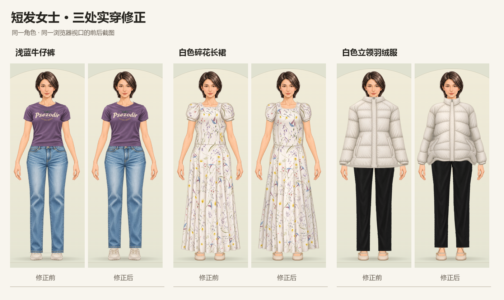

# WearMate · 碎花裙、羽绒服与裤长修正

**结论：三条裤子的鞋面露出有明确改善，碎花裙和羽绒服也更贴合当前正面站姿。** 裙子从胸腰到裙摆的过渡变得连贯，闭合羽绒服有更清楚的胸侧厚度和袖口层次。所有调整使用短发女士原有母版和现有衣物源图。

## 1. 三类问题的判断

- **裤装。** 三条裤子采用了不同的原始裤脚高度，覆盖鞋面的程度相差较大。牛仔裤两条裤脚之间还有一条源图透明边缘残影。问题在裤脚的对位和裁切。
- **碎花裙。** 旧版的袖子、方领和腰缝由同一套逐行变形驱动，在泡袖和裙身分开的地方容易显得扁。裙摆贴近鞋面，褶裥横向层次较少。
- **羽绒服。** 旧前片的袖口和下摆接近同一水平线，侧轮廓较平，胸口的绗缝缺少绕向两侧的转折。衣身、袖套和闭合领所需的遮挡也各不相同。

## 2. 三条裤长

以下坐标以 560 × 1536 人物画布的顶部为起点，数值为裤脚最下方的有效透明边缘像素行。只收短下腿段，保留裤腰、裆线和原裤脚车线。三种裤型仍是长裤，裤脚继续显示在鞋面之上。牛仔裤另清理了左右裤脚之间的透明边缘残影。

| 单品 | 裤脚前 → 后 | 同一双厚底鞋的露出面积前 → 后 | 修正后 |
|---|---:|---:|---|
| 浅蓝牛仔裤 `light-blue-jeans` | 1425 → 1389 | 61.5% → 92.5% | [浏览器截图](stage3a-special-fix-evidence/after-light-blue-jeans.png) |
| 黑色直筒裤 `black-trousers` | 1412 → 1386 | 74.1% → 94.5% | [浏览器截图](stage3a-special-fix-evidence/after-black-trousers.png) |
| 浅灰色直腿运动裤 `gray-joggers` | 1436 → 1394 | 50.7% → 89.0% | [浏览器截图](stage3a-special-fix-evidence/after-gray-joggers.png) |

面积按鞋自身 Alpha ≥ 128 且对应裤装 Alpha < 128 的像素比例统计。厚底鞋和玛丽珍鞋的图层沿用旧文件，测量隔离了裤脚变化。运动裤保留了比黑裤稍低的下摆，三条裤子都能看清厚底鞋的鞋带与鞋面。黑裤配玛丽珍鞋时也能看到细带。[裤脚对照图](stage3a-special-fix-evidence/pants-and-shoes.png) · [黑裤搭玛丽珍鞋](stage3a-special-fix-evidence/after-black-with-mary-janes.png) · [两双鞋的测量记录](stage3a-special-fix-evidence/fit-measurements.json)

## 3. 白色碎花长裙

从原碎花裙的穿戴源图给方领内缘、左右泡袖、袖口、胸腰和裙摆设置独立对位点，用连续二维曲面重新定位。方领落在锁骨下方，袖口包住上臂，前臂及手保留在袖口之外。腰缝与侧面增加很轻的收褶阴影，裙身褶线向下延伸，底边沿着原图的高低褶留出鞋带和鞋面。浏览器确认选择裙装后上衣与裤子隐藏，退出裙装恢复原组合。[修正前](stage3a-special-fix-evidence/before-dress.png) · [修正后全身](stage3a-special-fix-evidence/after-dress.png) · [实际工作台](stage3a-special-fix-evidence/after-dress-page.png)

## 4. 白色立领羽绒服

重新对齐立领、拉链、肩袖和袖口，闭合领的后片位于头颈后，带拉链的前片在衣身前。绗缝向胸侧回落，腋下补入有阴影的窄布片。衣身下摆落在胯上方，袖口比衣身边缘略低，手腕和手掌仍然可见。

衣服拉链闭合时，工作台按本人的这件外套遮住内搭上衣。和连衣裙叠穿时，只裁掉被封闭衣身挡住的裙装上部，外套下面的裙摆仍显示。搭配的真实衣物 ID 照常保留，脱下外套即恢复此前图层。深蓝内搭和裙装均在实际工作台复查。[修正前](stage3a-special-fix-evidence/before-coat.png) · [修正后工作台](stage3a-special-fix-evidence/after-coat-page.png) · [羽绒服叠碎花裙](stage3a-special-fix-evidence/after-coat-over-dress.png)

## 5. 复验和遗留

- Chrome 157 用同一短发角色、相同的 1440 × 900 视口截取前后画面，另检查 390 × 844 手机视口，无水平溢出。六组造型的脸部截图逐像素一致。[脸部比对](stage3a-special-fix-evidence/face-checks.json) · [手机截图](stage3a-special-fix-evidence/after-mobile.png)
- `node --test` 36 项通过。原有衣橱和 28 种真实浏览器分层组合回归通过。保留两层外套及单件裤装可独立切换。
- 运行版只更新了三张裤装、一张裙装以及外套的前后两张透明图层。商品展示、男女角色人体素材、上衣和双鞋文件继续沿用。可通过[原有对位脚本](scripts/fit-standard-bob.py)的 `--phase pants`、`--phase dress`、`--phase coat` 分别重建。外套遮挡限定在[现有工作台样式](src/studio.css)的标准母版。

这一轮最明显的收益是裤脚更利落、厚底鞋可以快速辨认。裙腰和羽绒服从正面看已有更清楚的体积。放大时，羽绒服两侧下摆的弧度仍比实物插画略强，碎花裙腰缝与细褶接触处可继续精修。当前羽绒服是闭合穿法，敞开穿法和侧视未在此轮验收。
