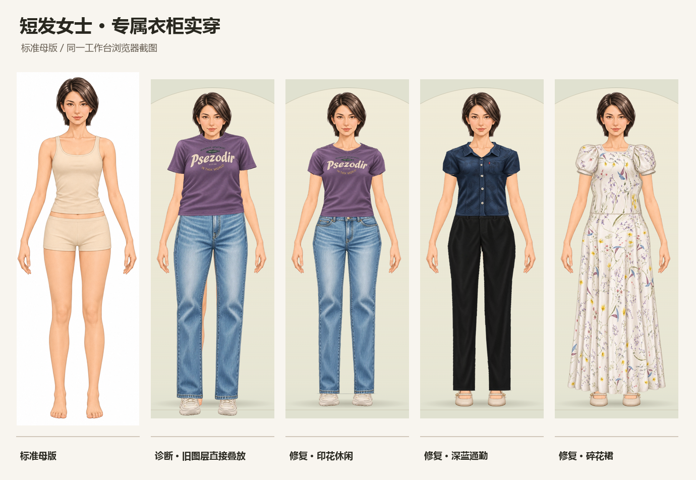

# WearMate · 标准母版的九件衣物实穿修复

**结论：短发女士 `woman-bob` 的九件专属衣物可以继续做最终视觉精修。** 印花休闲、深蓝通勤、碎花裙和羽绒服叠穿已在现有工作台试穿。新版 A 是紫色印花 T、浅蓝牛仔裤和厚底运动鞋，B 是深蓝衬衫、黑直筒裤和玛丽珍鞋。

## 问题判断

标准母版的正面轻 A 姿势、肩点、胯宽和脚底落点与旧穿戴版型不同。旧图层直接叠到这张母版时，上衣抬到肩颈上，牛仔裤内侧露腿，鞋底落点过低。原来照的衣柜商品图与实际穿戴图是不同资源。修复时以当前浅米打底母稿为底图，从旧透明穿戴图层重新对位，沿用原有颜色、图案与主要材质信息。

[白底母版](stage3a-tryon-fix-evidence/standard-base.png) · [原工作台的实际旧版造型](stage3a-tryon-fix-evidence/before-pilot.png) · [同一母版加载旧图层的诊断截图](stage3a-tryon-fix-evidence/same-base-legacy-fit.png) · [修复后的同款基础造型](stage3a-tryon-fix-evidence/after-pilot.png)

诊断截图在浏览器中将三件新版衣物的请求临时指向旧穿戴图层。旧版造型截图则取自开发前的实际工作台，使用的是此前的试衣人物。

## 修复方式

- [标准母版注册](src/create/bob-standard.mjs)记录 560 × 1536 画布、领口、左右肩、腰、双踝和脚位。对已定稿的白底图只做背景提取、等比定位与透明拆分，脸、发型、皮肤和身体轮廓来自同一张母稿。头颈与躯体交界保留窄重叠带，以压住浏览器缩放时出现的细缝。
- [衣物对位脚本](scripts/fit-standard-bob.py)对既有透明穿戴稿逐段重新采样。上身按领、肩、袖口和下摆对位，每条裤腿用独立内外缘定位，鞋按左右脚分别裁切与定位。裙摆沿固定边界采样以保留褶裥。全身图用于母版素材和证据，工作台读的是单件独立透明图层。
- [专属图层表](src/wardrobe/woman-bob-wardrobe.mjs)登记衬衫后领、羽绒服后领、人物头颈、鞋、裤、裙、外套前片的层次。玛丽珍鞋的开口透出母版真实脚背。连衣裙的上下装互斥和外套叠穿由已有状态逻辑执行。
- 适配代码沿用衣柜现有 ID、点击行为和收藏记录。对母稿、衣柜页面与 12 张商品图的 14 个文件做了哈希比对，均与修复前一致。

## 九件实穿状态

| 类别 | 现有单品 | 修复结果 |
|---|---|---|
| 上衣 | 紫色印花 T 恤 `purple-graphic-tee` | 下移领口并贴合肩线，分别对位袖口和胯上方下摆，保留中心印花。 |
| 上衣 | 深蓝色短袖衬衫 `navy-shirt` | 调整领尖和肩袖、下摆覆盖裤腰，剩余后领放到身体后。旧版横穿后颈的深色轮廓已消除。 |
| 裤子 | 浅蓝色牛仔裤 `light-blue-jeans` | 修复内侧露腿和裤脚错位，保留水洗纹、前袋和压线。 |
| 裤子 | 黑色直筒裤 `black-trousers` | 裤腰对齐，左右裤管沿腿型各自对位，轻提裤脚给细带鞋留出空间。 |
| 裤子 | 浅灰色直腿运动裤 `gray-joggers` | 延用抽绳和自然宽度，裆部及两条裤腿按新腿型贴合。 |
| 鞋 | 米白色玛丽珍鞋 `ivory-mary-janes` | 保留鞋带、鞋扣和开口，独立对位左右鞋，开口由底图肤色与脚背承接。 |
| 鞋 | 白色厚底运动鞋 `white-platform-sneakers` | 两只鞋分别落到双脚下方，裤脚叠在鞋面前侧。舞台脚底阴影对齐到新母版高度。 |
| 裙 | 白色碎花长裙 `floral-maxi` | 对位方领、泡袖和腰线，沿裙宽衔接花纹和褶裥。切裙时隐藏上下装，退裙后恢复。 |
| 外套 | 白色立领羽绒服 `white-puffer` | 保留绗缝和立领，肩部加留量盖住内搭，袖口对着手腕，前片覆盖内搭，后领位于头颈后。 |

## 浏览器证据

- 两套完整穿搭：[印花休闲 A](stage3a-tryon-fix-evidence/after-pilot-page.png) · [深蓝通勤 B](stage3a-tryon-fix-evidence/commute-page.png)
- 特殊单品：[碎花裙](stage3a-tryon-fix-evidence/dress-page.png) · [羽绒服加深色内搭](stage3a-tryon-fix-evidence/coat-page.png) · [羽绒服加碎花裙](stage3a-tryon-fix-evidence/coat-dress.png)
- 其他路径：[灰裤实穿](stage3a-tryon-fix-evidence/joggers.png) · [衣柜点试穿后](stage3a-tryon-fix-evidence/wardrobe-to-studio.png) · [手机工作台](stage3a-tryon-fix-evidence/mobile.png)

在 Chrome 157 分别使用 1440 × 900 和 390 × 844 视口。九件单品均从衣柜各自点击试穿，另跑通 28 种独立图层组合、裙装互斥、外套穿脱、保存与刷新。代表造型的脸部区域与 A 方案逐像素一致。[脸部截图数据](stage3a-tryon-fix-evidence/face-checks.json)

`node --test` 共 36 项通过，`verify-woman-bob.cjs` 通过。原天气页的四种模拟场景、保存和缺件处理回归通过。隔离环境的实时预报请求未连通。

## 后续精修范围

放大来看，紫色 T 恤的印花小字沿用原穿戴稿，鞋口与脚背的接触阴影仍可细化。部分宽裤脚与厚底鞋搭配时会挡住系带，黑裤配玛丽珍鞋则保留了鞋带的展示。羽绒服为拉链闭合穿法，近景可继续打磨腋下和袖口的厚度。[近景问题截图](stage3a-tryon-fix-evidence/remaining-details.png)

当前证据足以继续做这九件衣物的最终精修。历史记录如果使用旧展示专用的红 T、旧牛仔裤或旧低帮鞋，会提示对应图层暂不可用。九件正式衣物的已保存搭配沿用原 ID。
