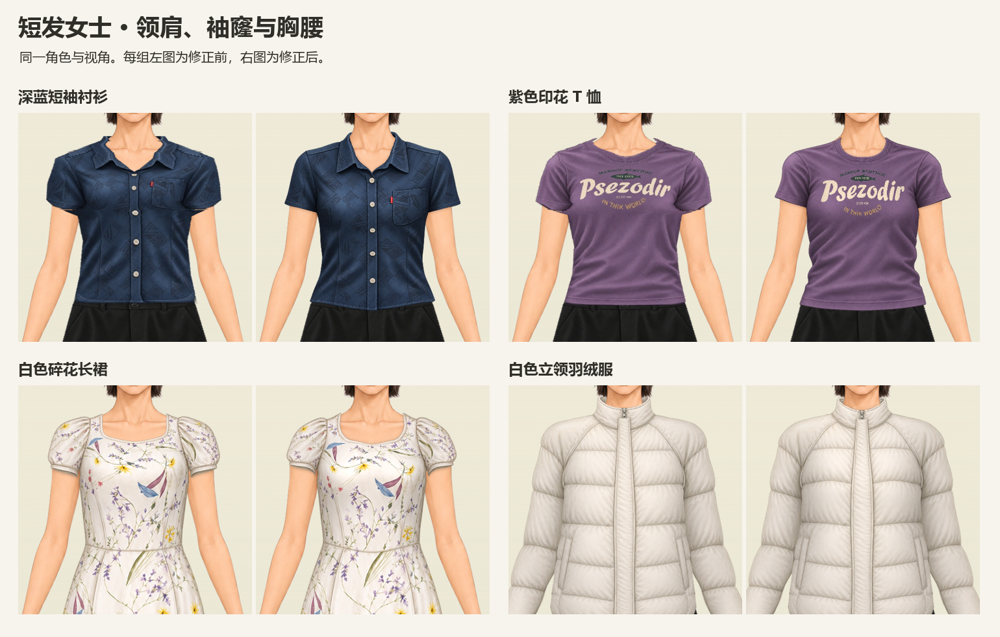
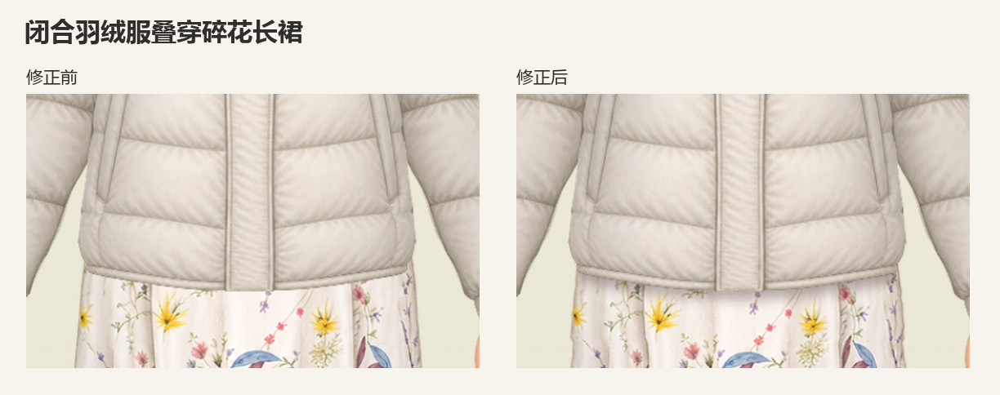

# WearMate · 短发女士上半身结构修正

本轮处理标准正面母版 `woman-bob` 的四件衣物。**改善最明显的是深蓝衬衫和紫色 T 恤**：衬衫的翻领、门襟、胸袋与袖窿现在能连续辨认，T 恤的圆领罗纹、印花和袖口也能沿各自的位置展开。碎花裙与羽绒服沿用已有版型，主要差异集中在领肩、胸腰以及两者叠穿时的下摆。人物母版和衣橱商品图沿用原文件。

## 共性问题与处理

| 部位 | 修前原因 | 本轮处理 |
|---|---|---|
| 领口与颈根 | 两件短袖此前先生成旧角色图层，再按每一行的总宽度缩放到标准人物。领边内外缘的位置互相牵动，圆领出现不连续的折角，翻领被压得过平。 | 从原衣物插画直接对位，将领侧、前中、肩根、领尖设为独立控制点。衬衫保留后领与前襟两层；四件衣服的领边接触阴影均限制在当前人物轮廓内。方领前中另减弱了局部缝线对比。 |
| 肩线、袖山与袖窿 | 短袖外缘结束的一行同时决定了整片胸口的宽度，袖口附近的图案容易横向扭折；在实际肩坡上，衬衫领尖旁还会露出窄肤边。 | 对照母版肩坡分别固定肩端、袖山、袖口内外端和腋下侧缝。按实际左右边线校准 T 恤。碎花裙把袖口略提到上臂，保留肩头泡量；羽绒服分别对齐立领、插肩衣片与袖片，保留斜向腕口。 |
| 胸口到腰线 | 胸袋、字样和碎花本来就在布面上，但旧变形没有分别约束胸廓、前中和腰侧；局部横线比衣料的转折更抢眼。 | 在同一人物坐标系内对位前胸、侧胸和腰侧。印花随布料一起变形，并共用从受光面到侧缝的柔和明暗。衬衫保留直门襟与弧形下摆，T 恤保留侧腰松量，裙子的前中腰缝略低于两侧。羽绒服的胸侧转折施加在原有绗缝上。 |

制作入口为[标准人物穿戴层导出脚本](scripts/fit-standard-bob.py)。在项目根目录运行 `python scripts/fit-standard-bob.py --phase upper` 可用 Pillow 和 NumPy 重新导出这四款上装相关图层。制作使用现有插画和手工确定的衣片对位点。

## 羽绒服下摆与内层

旧工作台在穿上外套时，以 `inset(44% 0 0)` 水平裁掉整条连衣裙的上段。露出的碎花保持单穿时的展开宽度，下摆下面也缺少接触阴影。

现在闭合外套会选择同一条裙子的叠穿裙片 `floral-maxi-under-coat`。它从外套内部起始，两侧按髋部实际余量收拢，往下逐渐恢复原裙宽，花纹跟随布料收放。投影由羽绒服前片真实的下缘生成，限制在髋部承接衣物的区域，叠裤装时也生效。脱下外套后自动恢复完整裙身。两片共用原裙装 ID，可独立更换鞋子、外套和内搭。[配置](src/wardrobe/woman-bob-wardrobe.mjs) · [工作台图层显示规则](src/studio.css)

## 四款试穿结果

| 衣物 ID | 正面实穿观察 | 浏览器全身截图 |
|---|---|---|
| `navy-shirt` 深蓝短袖衬衫 | 领尖沿锁骨两侧落下，门襟连续，胸袋下缘可辨。袖口下缘与裸露上臂衔接，胸袋附近的旧横折消失。 | [修前](stage3a-upperbody-structure-fix-evidence/before-navy.png) · [修后](stage3a-upperbody-structure-fix-evidence/after-navy.png) |
| `purple-graphic-tee` 紫色印花 T 恤 | 圆领有连续的凹弧，肩缝接上袖山。胸前字样保留原笔画，随布面向两侧回转，袖口处原有的横向挤压减轻。 | [修前](stage3a-upperbody-structure-fix-evidence/before-tee.png) · [修后](stage3a-upperbody-structure-fix-evidence/after-tee.png) |
| `floral-maxi` 白色碎花长裙 | 方领沿锁骨下方落下，泡袖下缘略提，前胸与腰侧的明暗差增大。腰缝仍可辨认，两侧顺着腰省过渡到裙身。此款改动幅度小于两件短袖。 | [修前](stage3a-upperbody-structure-fix-evidence/before-dress.png) · [修后](stage3a-upperbody-structure-fix-evidence/after-dress.png) |
| `white-puffer` 白色立领羽绒服 | 前领弧贴近颈根，原有袖口延续至手腕；最明显的改善在叠裙时，下摆、接触阴影与裙褶形成可见的前后关系。 | [修前](stage3a-upperbody-structure-fix-evidence/before-coat.png) · [修后](stage3a-upperbody-structure-fix-evidence/after-coat.png) · [修前叠裙](stage3a-upperbody-structure-fix-evidence/before-layered.png) · [修后叠裙](stage3a-upperbody-structure-fix-evidence/after-layered.png) |

## 复验与边界

- 在[正式工作台](http://127.0.0.1:4173/?view=fitting)通过单品按钮切换。修前与修后均使用 Chrome 157、1440 × 900 视口、3 倍设备像素比；下装和鞋固定为黑色直筒裤与米白玛丽珍鞋，裙装按原逻辑替代上下装。五组前后截图同位置的脸部像素一致。
- `node --test` 通过 36/36。`node scripts/verify-woman-bob.cjs` 通过衣橱试穿与 28 种分层组合。新增浏览器断言检查真正可见的裙片，覆盖单穿、加外套、脱下外套和外套配裤装。[回归脚本](scripts/verify-woman-bob.cjs)
- 在 560 × 1536 素材上复核，叠穿裙片起始行的有效像素全部被外套覆盖。髋部窗口 `128 ≤ x < 430, 650 ≤ y < 750` 内，人体 Alpha 大于 220 且外套、裙片 Alpha 均小于 128 的像素为 0。[检查记录](stage3a-upperbody-structure-fix-evidence/checks.json)
- **仍有的视觉局限**：方领包边在近距离下仍可见，碎花裙细小的受力褶皱和羽绒服左右绗缝仍主要来自原插画。当前效果适用于这位角色的固定正面站姿和闭合外套穿法。
