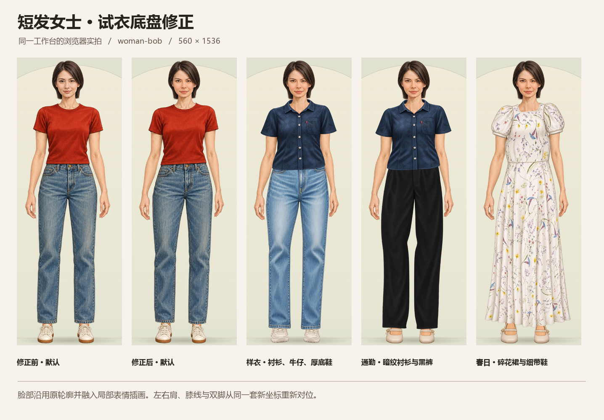
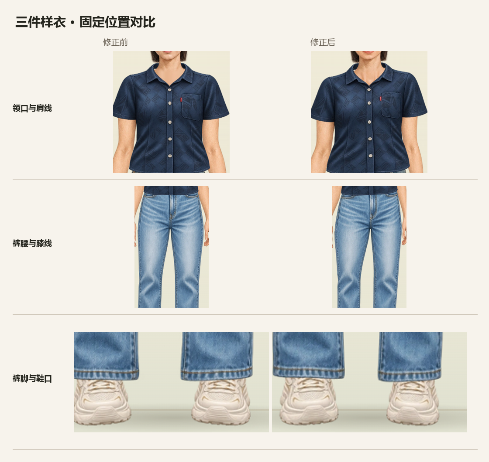

# WearMate · 短发女士试衣底盘视觉修正

**结论：短发女士 `woman-bob` 已具备进入最终视觉精修的基础。** 本轮先校准人物站姿和对位关系，等深蓝衬衫、浅蓝牛仔裤和厚底运动鞋的样衣组合通过浏览器复查后，再处理普通衣物和两件特殊单品。通勤、周末、碎花裙和羽绒服均有实际工作台截图。近景美术仍有细节可继续打磨。

## 1. 为什么先修底盘

旧角色的双肩、胯部和双脚接近正面平行，垂下的双臂也近似镜像。换衬衫、牛仔裤和鞋时，袖口和身体的关系依旧显得僵直，裤腿与双脚失去重心变化，衬衫打开的领口则露出一片平坦的肤色。上衣、裤子、鞋和外套都使用这些坐标。先确定站姿、领口和脚部接触点，可让同一部位在各套衣服下保持一致。旧素材中印花清晰度和脚背明暗属于单件美术问题，另行记录。[旧默认形象](stage3a-visual-repair-evidence/before-default-page.png) · [旧样衣组合](stage3a-visual-repair-evidence/before-pilot-page.png)

## 2. 人物表现和结构

- **身份和神态。** 以原角色的发型、发际线、脸部外轮廓和下颌为基准，用内置 ImageGen 制作神态候选，再把候选的眼、面颊和嘴角局部对齐后羽化。保留原头发及脸型边缘。锁骨明暗另做透明衔接层，深蓝衬衫与碎花裙打开领口时，能看见从颈部到胸口的过渡。
- **肩线、重心与裤腰。** 在 560 × 1536 坐标内，肩点由 `(147,266) / (404,269)` 调整为 `(150,273) / (410,261)`，腰点从 `(274,566)` 移到 `(284,566)`。颈点移到 `(283,260)`，肩高差、腰胯和两侧手臂保留一前一后的轻微视觉差，门襟仍接近正面。
- **膝线与脚位。** 两脚踝中心由 `(159,1422) / (361,1422)` 收近到 `(178,1418) / (348,1425)`。膝部和裤脚分段过渡，脚踝旧素材的局部暗残边做了补色。默认红 T、牛仔裤和浅米鞋同样对到了新站姿。
- **图层连续性。** 角色 ID、三张基础图层、画布尺寸及叠穿规则延用。新底盘分支通过独立锚点和 Alpha 区域校验。以角色专属二维网格离线重新定位透明衣物，运行时仍一件一件显示。衣物目录的 13 张透明图层另外包含后领、脚背及领口等小图层。

[新版默认工作台](stage3a-visual-repair-evidence/after-default-page.png) · [站姿坐标](artwork/woman-bob/pose.json) · [分层输出脚本](scripts/refine-woman-bob.py)

制图记录。内置 ImageGen 以原角色头部插画为参考，用于开发期绘制表情候选。核心提示词为“保留同一成年女性的深棕色侧分短发、脸型、五官比例、肤色和正面朝向。闭口微笑略不对称，目光更有神，使用哑光手绘的轻写实服装插画画法，透明头颈图层”。运行项目时直接读取本地 WebP。[对齐表情](artwork/woman-bob/expression.webp) · [锁骨明暗衔接](artwork/woman-bob/collar-light.webp)

## 3. 三件样衣验证

| 单品 | 修正前 | 修正后 |
|---|---|---|
| 深蓝衬衫 `navy-shirt` | 两侧肩和袖口接近水平，开领下较平 | 袖口跟随两侧肩高，后领与肤色衔接更有层次，暗纹、胸袋和门襟连续 |
| 浅蓝牛仔裤 `light-blue-jeans` | 胯、膝和两腿接近对称 | 裤腰随胯部略移，左右裤腿的落向收向新脚位，保留水洗、缝线和裤口 |
| 白色厚底运动鞋 `white-platform-sneakers` | 两脚间距较大，裤腿和鞋视觉上呈平行摆放 | 两鞋口跟随各自踝点，裤脚压在鞋舌上方，系带与厚鞋底仍可分辨。正面视角只能判断可见鞋头、鞋口和外底 |

[前版三件组合](stage3a-visual-repair-evidence/before-pilot.png) · [新版三件组合](stage3a-visual-repair-evidence/after-pilot.png)

## 4. 普通衣物修正进度

两件上衣、三条裤子、两双鞋共七件已切换到新底盘。紫 T 的袖口与肩高重新对齐，主体印花和原色得以保留。黑色直筒裤和浅灰运动裤调整了膝线与脚踝位置，保留直筒和宽腿各自的轮廓。米白玛丽珍鞋继续使用跟鞋面分离的脚背层，双脚一起对到新位置。

- 周末穿搭为紫 T、浅蓝牛仔裤和厚底运动鞋。[实际工作台](stage3a-visual-repair-evidence/after-casual-page.png)
- 通勤穿搭为深蓝衬衫、黑裤和玛丽珍鞋。[实际工作台](stage3a-visual-repair-evidence/after-commute-page.png)
- 宽腿灰裤搭配为紫 T、灰裤和厚底运动鞋。[实际工作台局部](stage3a-visual-repair-evidence/after-joggers.png)

现有精修名单之外，拼浅蓝领上衣、白卫衣和裸色细高跟仍为未纳入单品。前两件需要独立制版，细高跟需要抬跟姿势和不同足型。现有紫 T 印花小字、玛丽珍鞋脚背明暗，以及部分裤脚和鞋面接触阴影，仍有精修空间。[近景限制截图](stage3a-visual-repair-evidence/remaining-details.png)

## 5. 特殊单品

- **碎花裙。** 布纹、方领、泡袖和裙摆保留，腰部贴合新姿势，裙摆下仍能辨认两只鞋。浏览器实际选择裙子后，上衣和裤子退场，点「切回上衣与裤子」恢复原组合。[碎花裙与细带鞋](stage3a-visual-repair-evidence/after-dress-page.png)
- **白羽绒服。** 后领在头后，前片覆盖已选内搭，手从袖口露出。浏览器分别检查了深蓝衬衫加黑裤、碎花裙两套叠穿，代表截图里未看到明显的内搭穿透。羽绒绗缝仍可辨认，长裙裙摆保持可见。[外套叠深色内搭](stage3a-visual-repair-evidence/after-coat-page.png) · [外套叠碎花裙](stage3a-visual-repair-evidence/after-coat-dress.png)

## 6. 验收与下一步

- `node --test` 35 项通过。覆盖本角色的底盘与默认装同时解析、角色素材隔离、衣物透明素材格式和推荐规则。
- Chrome 157 实测了修正前、样衣阶段与最终版。最终版从正式目录加载。桌面使用 1440 × 900，移动端使用 390 × 844。逐件核对独立换装、穿脱外套、裙装互斥及返回、保存与天气方案试穿。六组换装截图采用相同的脸部区域比较，变化像素为零。[脸部一致性](stage3a-visual-repair-evidence/face-consistency.json) · [手机视口](stage3a-visual-repair-evidence/after-mobile.png)
- `node scripts/verify-woman-bob.cjs` 的 28 种组合全部通过。组合检查核对可见图层和交互，深度视觉检查集中在截图所列的代表穿搭。
- `node scripts/verify-today.cjs` 在隔离预览中通过四种模拟天气、保存、缺件与断网行为。本次隔离预览的真实天气请求未连通，实时预报本轮未重新验收。

后续精修可先从玛丽珍脚背与鞋带接触阴影、紫 T 字样和裤脚处的接触阴影入手。这些位置可单独调整，不需要再改角色站姿。正式项目可用 `node scripts/serve.mjs 4173` 启动，刷新工作台即可看到新底盘。[本地工作台](http://127.0.0.1:4173/)
